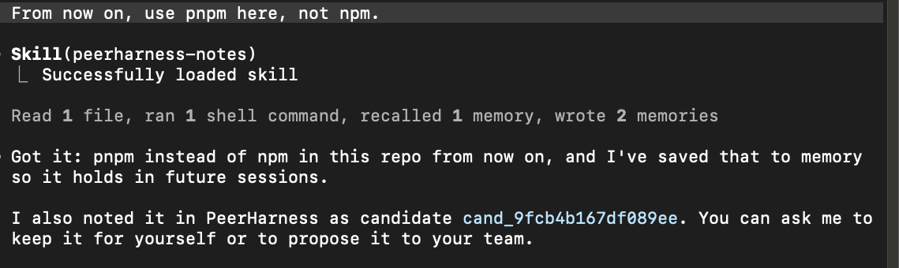

# PeerHarness

**Your team votes on how its AI coding agents behave.**

**Works with:** Claude Code, Codex, Gemini CLI, Cursor, GitHub Copilot CLI, opencode,
Pi, Google Antigravity, Qwen Code, Amp, Factory's Droid, Crush, Kilo, goose and
DeepSeek Harness ([how each one connects](docs/terminal.md#other-coding-agents)).

You correct your coding agent ("no, use pnpm, not npm"). PeerHarness turns the
correction into a one-sentence rule. Keep it for your own agent, or propose it to your
team: once a majority approves, every member's agent follows it. There is no server.
Each person runs their own node with their own keys, and every node checks every
signature and counts every vote for itself.



Agents suggest, people decide. Your agent can note a rule and open a window on your
screen that shows the exact text. It cannot answer the window: inside its session,
keeping a rule, sharing one, voting, inviting and joining take your click. That stops
an agent that is trying to help. It is not a sandbox ([Limits](#limits)).

> **Status: v0.5.0, early and not audited.** Made for Claude Code on macOS first; the
> other agents get the rules and the tools, and seven of them the hook that notices a
> correction. On Linux it works from a terminal, without
> the windows. Windows is not supported. Read [Limits](#limits) before you rely on it.

PeerHarness is also a command-line tool (CLI): every step here is a command too, and
you can run it yourself without an agent. See [From a terminal](#from-a-terminal).

## Set it up

Paste this into your coding agent: Claude Code, Codex, Gemini CLI, Cursor, Copilot CLI
or [another one PeerHarness connects](docs/terminal.md#other-coding-agents).

```text
Set up PeerHarness for me: https://github.com/aryehlev/peerharness

1. Install it:
   curl -fsSL https://raw.githubusercontent.com/aryehlev/peerharness/main/install.sh | sh
2. The next step is mine. It is where I allow what you may start for me, so do not
   run it yourself: it would be refused. Ask me to run this in my own terminal:
   ~/.local/bin/peerharness setup

Then tell me to start a new session, and what I can ask you there.
```

* **Your agent installs it.** The install line downloads the release binary for your
  machine, checks it against the release's `SHA256SUMS` and puts it in `~/.local/bin`.
  No `sudo`, and nothing else is changed.
* **You run `setup`, once.** It is where you allow what your agent may start for you,
  so your agent is refused it. It creates your key and database and connects
  PeerHarness to Claude Code (two hooks, one skill and its tools) and to the other
  agents it finds. It shows each change before it makes it and asks you to confirm.
* **What it stores.** One hook keeps a redacted copy of each prompt you type, so that
  corrections can be noticed. The copies stay on your machine, for 14 days by default,
  in a database that is not encrypted.

Then start a new session of your agent and [try it](#try-it-in-your-agent).

**Other coding agents.** For each of the 14 others it finds (Codex, Gemini CLI, Cursor,
Copilot CLI, opencode, Amp, goose and more), `setup` shows a preview and then puts your
rules in the skills it reads and gives it the same tools. For goose and DeepSeek
Harness it shows the tools entry for you to add yourself. If you use `goose term
init`, run `setup` from a shell without it: PeerHarness takes that shell for goose's.
Codex, Droid, Gemini CLI, Qwen Code, Cursor, Copilot CLI and goose also get the hook
that notices a correction, after a preview of what it stores; in the other
seven a correction is noted only when the agent notes it. See
[other coding agents](docs/terminal.md#other-coding-agents).

More: [what setup adds and stores](docs/terminal.md#what-setup-adds-and-what-is-stored)
and [how to take it out again](docs/terminal.md#take-it-out-again).

## Try it in your agent

Start a new session of your agent and say these, one at a time. You need no teammate
for it.

1. **"From now on, use pnpm here, not npm."** Your agent notes the rule ("Use pnpm,
   not npm, in this repository.") and tells you it did. It does the same when you
   correct it in the middle of work.
2. **"Keep it."** A window shows the exact rule. Click Proceed: the rule is installed
   for your own agent, which reads it from its next session. Nothing is shared.
3. **"Create a PeerHarness team called acme."** You are its only member for now.
4. **"Propose the pnpm rule to acme."** A window shows the exact text that would leave
   your machine. Click Proceed: the rule is put to your team's vote.
5. **"Vote approve on it."** A window shows your ballot. Click Proceed: one of one
   members approved, so the rule passed and is now your team's.

Every window has the exact text and two buttons, Cancel and Proceed. Cancel is the
default, and your agent cannot answer the window. This is the one for the vote:

```text
Your coding agent started this step. Nothing happens unless you choose Proceed.

You are about to sign a ballot in acme:
  approve on "Use pnpm, not npm, in this repository." (adopt rule use-pnpm-not-npm-repository)
An approval cannot be withdrawn. The rule, exactly as proposed:

---
name: use-pnpm-not-npm-repository
description: Use pnpm, not npm, in this repository.
---

# Rule

Use pnpm, not npm, in this repository.

If this conflicts with what the user asks for in the current session, follow the user and say that it conflicts with this rule.
```

After that, **"What is in my PeerHarness inbox?"** lists the rules your agent noted
and the proposals that wait for your vote, and **"Anything new in PeerHarness?"**
exchanges with the other members first.

A rule is never installed by itself: you keep it, or your team votes it in. A rule
your team passed is installed for every member's agent as an
[Agent Skill](https://agentskills.io/specification) when their node learns of it,
without a window. You can have your node ask you first, and you can opt out of any
single rule on your own machine.

### Add a teammate

Dana wants to join acme. She sets PeerHarness up as above, and then:

1. **Dana:** "What is my PeerHarness device key, and its fingerprint?" She sends you
   the key. It is a public key, not a secret: chat is fine, and so is giving it to
   your agent.
2. **You:** "Invite Dana to acme. Her device key is ed25519:…" A window shows the
   fingerprint of the device you would admit. Before you click, have Dana read hers
   to you, by phone or in person. If they match, Proceed. Your agent then keeps your
   node reachable and tells you what Dana needs: your node's peer id, by any channel,
   and the team's root fingerprint, which you tell her the same way.
3. **Dana:** "Join the team. The peer id is 12D3…, the fingerprint is 8e8d-…" A window
   shows the fingerprint and who is in the team. Proceed joins.

The two fingerprints are how each of you knows the other. Hers tells you that the
device you admit is Dana's and not one that was put in its place on the way: whoever
holds it gets a vote. The team's tells her that the team is yours. So both are said
aloud, apart from what travels by chat. From then on a rule needs both of your votes,
and so does admitting a third member, asked in the same kind of window. PeerHarness's
own word for a team is a *circle*.

A few steps are still done in a terminal: they are [at the bottom](#from-a-terminal).

## How a vote works

A vote among three members, from the output of the built-in demo, abridged:

```text
5. Alice puts it to the vote.
    alice approves.
    carol rejects: "Our CI images only ship npm."
    open: 1 of 3 approved (2 needed), 1 dissenting
    bob approves.
    Every node counts for itself and agrees: passed: 2 of 3 approved (2 needed), 1 dissenting
    No one held a veto, and carol's dissent stays on the record.

6. The charter is binding, so the rule is installed for every member's agent.

7. Carol opts out of this one rule. That is her right, and only her machine changes.

8. What cannot happen:
    Mallory signs a ballot. She is not on the roll: refused.
    The founder's root key signs a charter that adds Mallory without a vote.
    The signature is valid and every node still refuses it: the key is a notary, not a ruler.
```

* **One person, one vote**, however many devices they have.
* **A majority of everyone entitled to vote.** Not voting counts as not approving.
  Nobody has a veto: a `reject` is recorded with its reason and does not block.
* **No deadlines and no coordinator.** A member cannot withdraw an approval, and
  counting reads no clock, so two nodes that hold the same records always agree.
* **Membership is voted too.** Admitting or removing a member and changing the
  thresholds need a vote. The founder's key signs the resulting charter, and nodes
  refuse any charter that a passed vote does not justify.
* **A passed rule takes effect.** It is installed for every member's agent, and any
  member can opt out of a single rule on their own machine.

No vote and no charter can switch these off:

1. Nothing leaves your machine without you seeing the exact text and confirming it.
2. PeerHarness never executes a rule. A rule is one instruction-only `SKILL.md`; tool
   pre-approval and shell-injection syntax are refused outright.
3. No vote grants read access.
4. A rule with high-risk content is never installed without asking you.
5. You can refuse a rule and you can leave.

## Why not a CLAUDE.md in git?

If the rule is about one repository and your team already reviews pull requests,
commit the file. You need nothing else. PeerHarness is for rules that follow people
across repositories, for groups with no shared repository or nobody who administers
one, and for members who want to see the exact text they vote on and to opt out of a
rule alone.

It is also more dynamic and more democratic. A rule starts as a correction in the
middle of work, with no file to edit and no pull request to open. And it passes by a
majority of everyone, not by the say of whoever can merge.

## Limits

* **The agent guard is not a sandbox.** A session is recognized by an environment
  variable that the agent sets, and Antigravity documents none. A process running as you that hides it
  can run the same commands with `--yes`. Your agent chooses when a window appears:
  reading it before you click is your part.
* **A rule is text that your agent acts on**, and your agent can run commands. The
  risk scanner and the redaction are heuristics. Read a rule as you would a script.
* **Joining installs rules you have not read.** The join window shows the charter and
  how many rules it carries, not their text. You can opt out of any afterwards.
* **The founder can revoke a device without a vote**, for a lost laptop. Its ballots
  stop counting, so a result that needed one is undone. The founder's key also signs
  every change of the roll: if it is lost, nobody can be admitted or removed.
* **No secret ballot**, and at most 64 members. A member who never votes makes every
  threshold harder to reach.
* **A node is reachable only while a daemon runs**: yours, or the one your agent runs
  while its session is open. There is no background service yet.
* **Internet mode** shows your node's public key and IP address to servers run by
  volunteers.

The full list is in [docs/limits.md](docs/limits.md).

## From a terminal

PeerHarness is one binary, `peerharness`, and a command-line tool by itself. Every
step above is also a command, and [PeerHarness from a terminal](docs/terminal.md) has
each one. These are done there and not through your agent:

* **A node that stays reachable.** Your agent keeps yours reachable only while its
  session is open. For one that stays up:
  `peerharness daemon --internet --sync-every 60`, and on macOS add `--notify`.
* **Being asked before a passed rule is installed**
  (`peerharness circle mode ask --circle <team>`), and opting out of one rule
  (`peerharness rule opt-out <name> --circle <team>`).
* **Removing a member, leaving, changing the rules of the vote and repealing a rule.**
* **Editing or rejecting a noted rule**, and anything about a rule that the scanner
  calls high-risk.
* **Every decision on Linux**, where no window can be shown.

Without the prompt, run the `curl` line from [Set it up](#set-it-up) and then
`~/.local/bin/peerharness setup`. To see the vote above run on your machine:
`peerharness demo`. It needs only the binary, creates three members and one outsider
in a temporary folder, each with its own key and database, and reads or changes
nothing in your home or in `~/.claude`.

## Documentation

* [docs/terminal.md](docs/terminal.md): every step as a command, the other ways to exchange, and how to take it out again
* [docs/limits.md](docs/limits.md): what it does not do, or not yet
* [docs/checked.md](docs/checked.md): how each part was checked
* [docs/security-model.md](docs/security-model.md): threats, guarantees and limits
* [docs/architecture.md](docs/architecture.md): the internal contract every crate follows
* [docs/protocol-v0.md](docs/protocol-v0.md): the wire format, for a second implementation
* [docs/decisions.md](docs/decisions.md): decisions and why they were made
* [CHANGELOG.md](CHANGELOG.md): what each version added

## Development

Written from 9 to 11 November 2026 with Claude Code, as the commit trailers say,
from the brief in [docs/spec.md](docs/spec.md). To build and test, see
[CONTRIBUTING.md](CONTRIBUTING.md). To report a vulnerability, see
[SECURITY.md](SECURITY.md).

## License

MIT or Apache-2.0, at your option.
